<div align="center">

# 📰 NewsMind

### Read less. Understand more.

**Retrieval-augmented summarization and question answering over a large news corpus.**


*A PBL project that turns every topic on the NLP syllabus into one working product.*

</div>

---

## 📑 Table of contents

1. [What is NewsMind?](#-what-is-newsmind)
2. [The big picture](#-the-big-picture)
3. [No paywall scraping](#-no-paywall-scraping)
4. [Features and syllabus coverage](#-features-and-syllabus-coverage)
5. [The data](#-the-data)
6. [How it works](#-how-it-works)
7. [Summarization](#-summarization)
8. [Topics and evaluation](#-topics-and-evaluation)
9. [The app](#-the-app)
10. [Quick start](#-quick-start)
11. [Configuration](#-configuration)
12. [Project layout](#-project-layout)
13. [Current index](#-current-index)
14. [Quality checks](#-quality-checks)
15. [Limitations and roadmap](#-limitations-and-roadmap)
16. [Documentation and glossary](#-documentation-and-glossary)

---

## ✨ What is NewsMind?

There is far more news than anyone can read, and a chatbot asked about the news may simply
make things up. NewsMind tackles both problems. It reads a large collection of news
articles and gives you three things:

| | Capability | What you get |
| --- | --- | --- |
| 📝 | **Summarize** | Shrink any article using five different methods and compare them side by side. |
| 💬 | **Ask** | Plain-English answers built *only* from retrieved articles, each with citations. |
| 🔭 | **Discover** | Topic modelling that shows the themes hiding in thousands of headlines. |

> **An analogy.** Picture a huge library of newspaper clippings. A *librarian* quickly pulls
> the most relevant clippings, a strict *editor* keeps the best five, and a *writer* composes
> an answer from those five and footnotes every claim. That is Retrieval-Augmented Generation
> (RAG).

---

## 🗺 The big picture

<p align="center">
  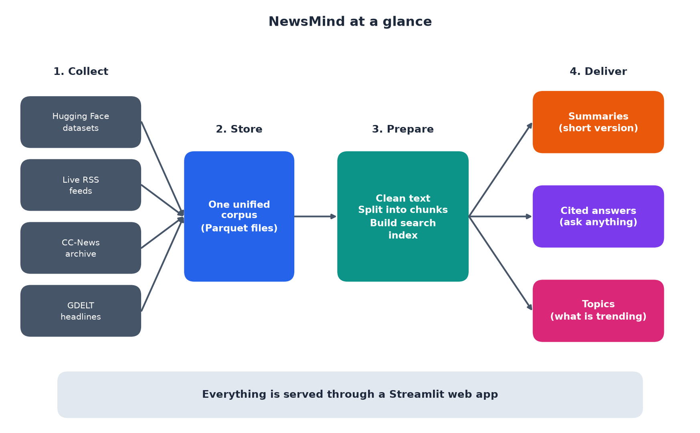
</p>

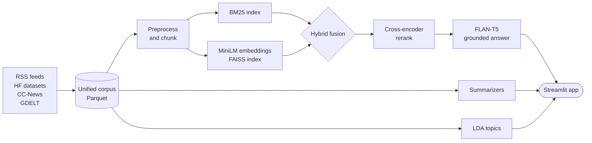

---

## ⚖️ No paywall scraping

NewsMind **does not scrape or store full HTML bodies** from The New York Times, The Wall
Street Journal, The Washington Times, Hindustan Times, The Times of India or The Indian
Express.

Those outlets appear only through two legitimate doors:

1. **Official RSS**: headlines plus the blurbs / `content:encoded` that publishers choose to share.
2. **CC-News research archive**: a public academic dataset, filtered into
   `outlet_archive.parquet` with `uv run newsmind-outlets`.

No paywalls are bypassed and no terms of service are broken, so the project can be shared
and reproduced openly.

---

## 🎯 Features and syllabus coverage

| Synopsis item | Implementation |
| --- | --- |
| Tokenization / lemmatization | NLTK WordNet pipeline (`preprocess`) |
| POS / noun phrases | `preprocess.syntax` |
| TF-IDF retrieval | `retrieve.TfidfRetriever` |
| BM25 sparse retrieval | `retrieve.BM25Retriever` |
| Word2Vec / GloVe | `retrieve.word2vec`, `retrieve.glove` |
| Dense embeddings + FAISS | MiniLM + hybrid fusion |
| Cross-encoder rerank | ms-marco MiniLM |
| Extractive summarization | TF-IDF + TextRank |
| Abstractive summarization | BART, T5, Pegasus |
| LDA topics | Gensim LDA |
| RAG QA + citations | BM25 + dense → rerank → FLAN-T5 |
| Evaluation | ROUGE, EM, F1, Precision@k / Recall@k |
| Demo | Streamlit: Read / Compare / Topics / Eval |

---

## 🗄 The data

Eight Parquet files live in `data/raw/` (about **3.9 GB** in total).

<p align="center">
  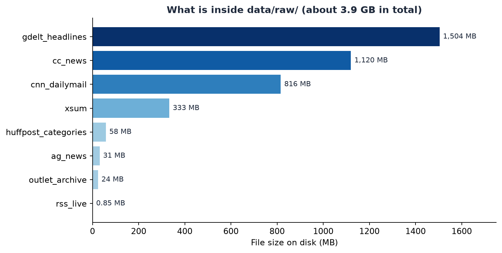
</p>

| File | Contents | Used for |
| --- | --- | --- |
| `cnn_dailymail` | Articles with human-written highlights | Summarization, ROUGE references |
| `xsum` | BBC articles with one-sentence summaries | Very short abstractive summaries |
| `cc_news` | Common Crawl news | Large, diverse text |
| `gdelt_headlines` | Huge headline collection | Reaching the 10M-row scale target |
| `ag_news` | Snippets with topic labels | Topic checks |
| `huffpost_categories` | Headlines with categories | More labelled topics |
| `outlet_archive` | Named outlets from CC-News | NYT, WSJ, TOI and others, legally |
| `rss_live` | Today's official RSS headlines | Fresh news |

### One schema for everything

Every source is normalized into the same ten-field record (`schema.ArticleRow`), so the
rest of the code never cares where an article came from.

<p align="center">
  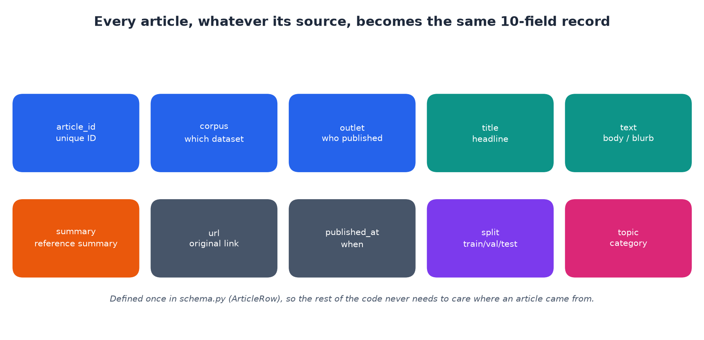
</p>

---

## ⚙️ How it works

### 1. Preprocessing

Text is tokenized, stripped of stop-words and lemmatized with NLTK; a syntax module adds
part-of-speech tags and noun phrases.

<p align="center">
  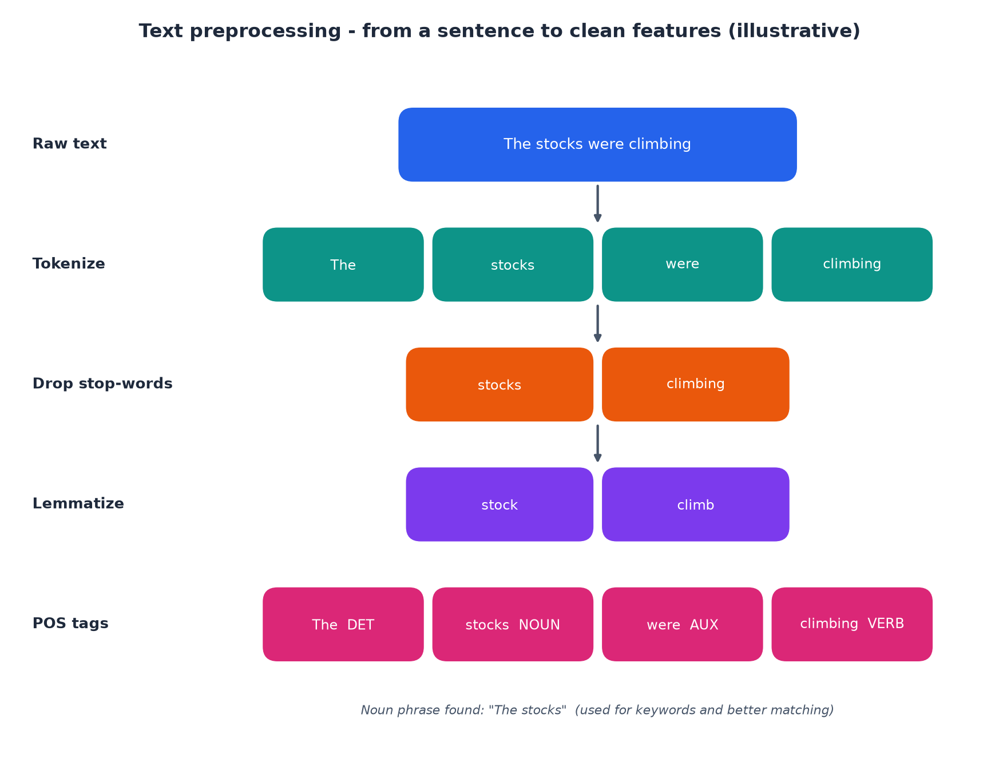
</p>

### 2. Chunking

Articles are cut into sentence-aware passages of about **900 characters** with a
**120-character overlap**, so no sentence is stranded at an edge.

<p align="center">
  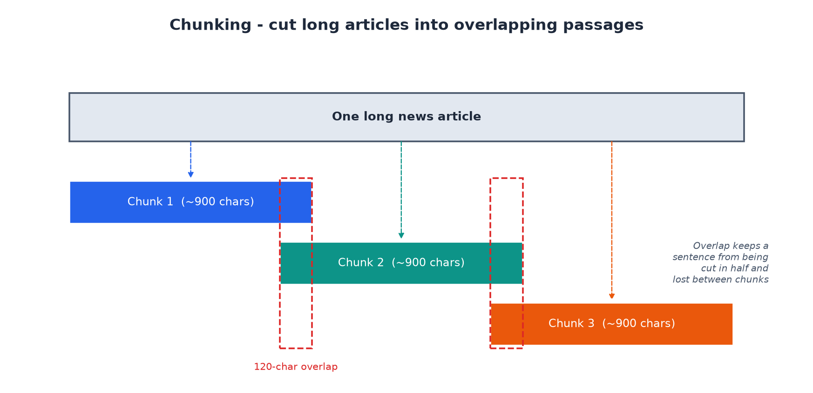
</p>

### 3. Retrieval, from simple to smart

<p align="center">
  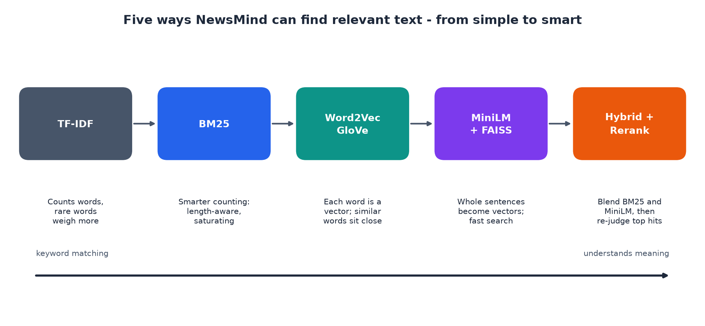
</p>

| Method | Idea | Strength | Weakness |
| --- | --- | --- | --- |
| TF-IDF | Rare words matter more | Simple, fast | Ignores meaning |
| BM25 | Length-aware TF-IDF | Great for names, numbers | Misses paraphrases |
| Word2Vec / GloVe | Words as vectors | Word similarity | No context |
| MiniLM + FAISS | Sentences as vectors | Understands paraphrases | Can drift off-topic |
| Hybrid | Blend BM25 and MiniLM | Best of both | Needs a tuned weight |
| Cross-encoder | Reads question and passage together | Most accurate | Too slow for everything |

Keyword search and meaning search fail in *different* ways, which is why NewsMind combines them:

<p align="center">
  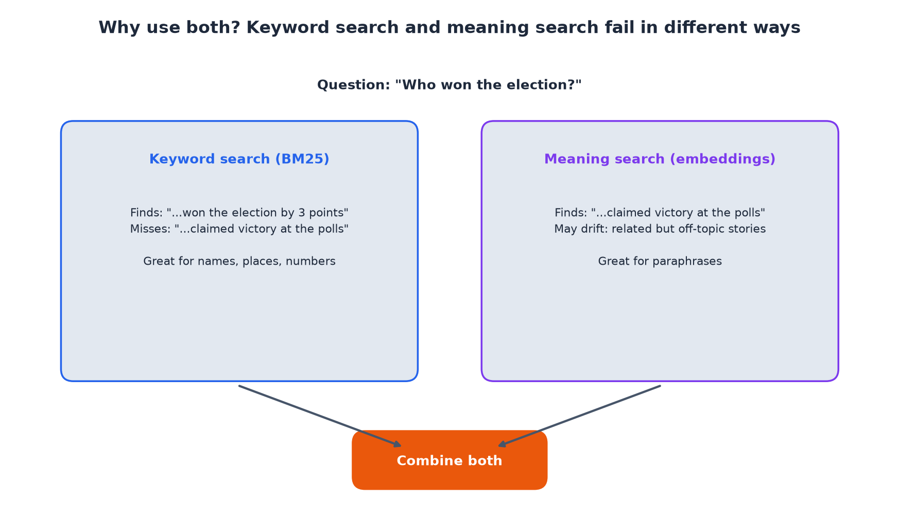
</p>

Scores are min-max normalized and blended: **0.55 dense + 0.45 BM25**
(`HYBRID_ALPHA` in `config.py`).

<p align="center">
  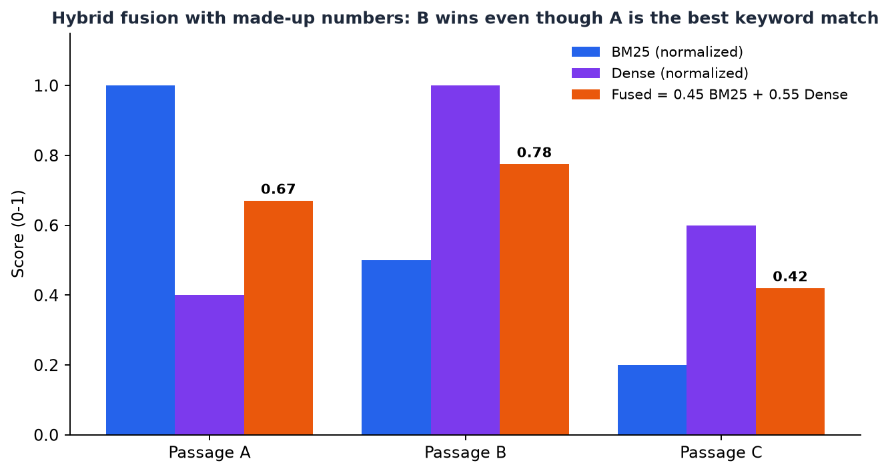
</p>

### 4. The retrieval funnel

<p align="center">
  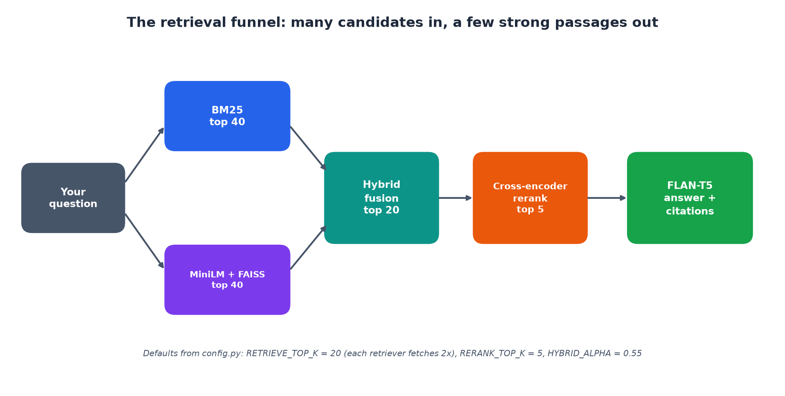
</p>

With the defaults (`RETRIEVE_TOP_K = 20`, `RERANK_TOP_K = 5`), BM25 and dense search each
fetch 40 candidates, fusion keeps 20, the cross-encoder keeps 5, and FLAN-T5 answers from those 5.

### 5. Question answering with receipts

`RAGSystem.ask_traced()` runs six steps and records inputs and outputs for each, so the app
can show the whole reasoning trail, not just the answer.

<p align="center">
  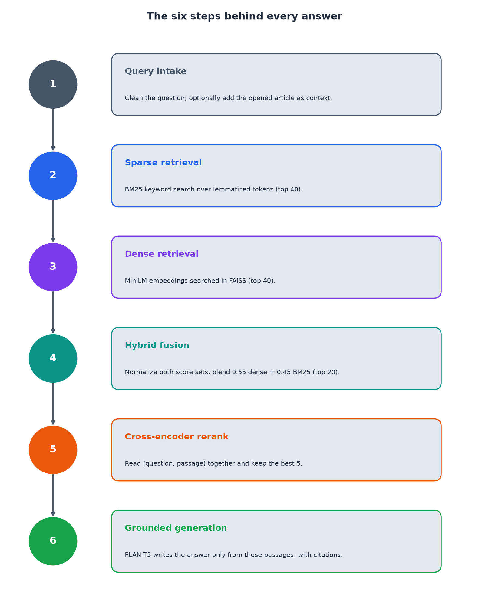
</p>

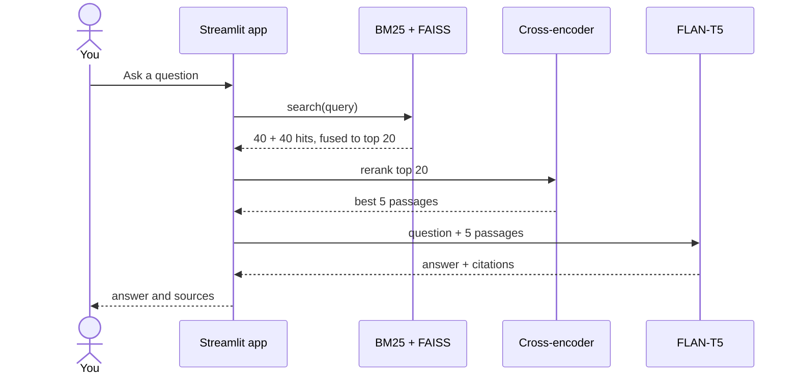

> **Safety net.** If the language model returns an empty or degenerate reply, NewsMind falls
> back to quoting the retrieved passages, still with citations.

### Models used

| Job | Model |
| --- | --- |
| Sentence embeddings | `sentence-transformers/all-MiniLM-L6-v2` |
| Reranking | `cross-encoder/ms-marco-MiniLM-L-6-v2` |
| Answer generation | `google/flan-t5-base` |
| Abstractive summaries | `facebook/bart-large-cnn`, `t5-small`, `google/pegasus-xsum` |
| Word vectors | `glove-wiki-gigaword-100` |

---

## 📝 Summarization

<p align="center">
  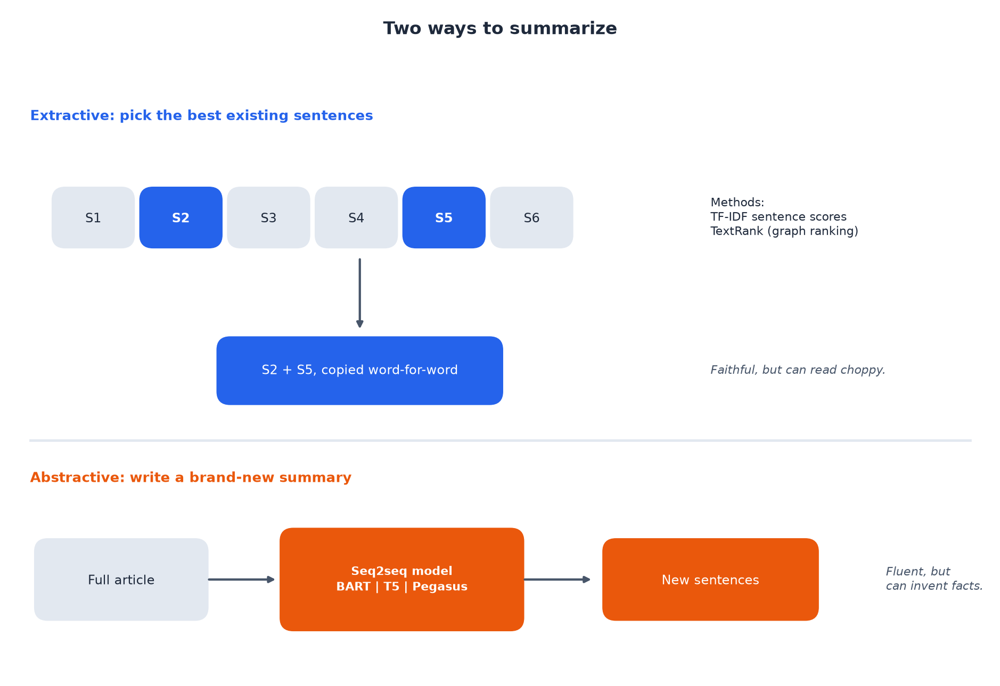
</p>

| Mode | How it works |
| --- | --- |
| Extractive TF-IDF | Scores sentences by distinctive-word weight; keeps the top 3 in original order. |
| Extractive TextRank | Graph ranking where sentences "vote" for each other. |
| Abstractive BART | Fluent multi-sentence summaries (`bart-large-cnn`). |
| Abstractive T5 | Compact text-to-text model (`t5-small`). |
| Abstractive Pegasus | Single punchy sentence (`pegasus-xsum`). |

**Rule of thumb:** need to quote or verify? Use extractive. Want something pleasant to read?
Use abstractive, but double-check the facts.

<p align="center">
  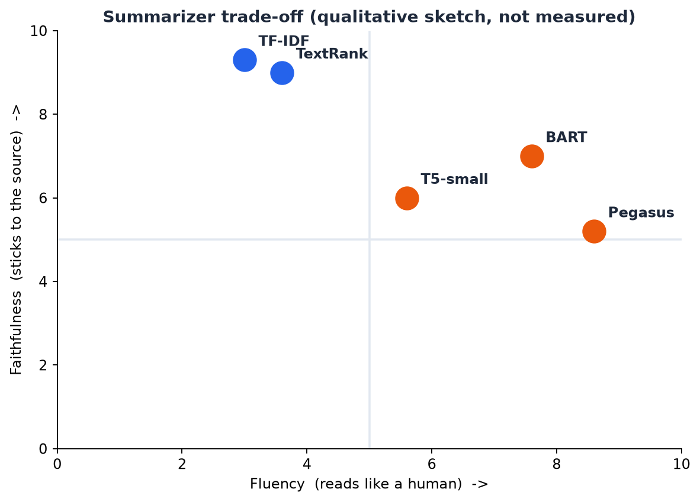
</p>

---

## 📊 Topics and evaluation

**Topics.** Gensim LDA discovers hidden themes (for example *election, vote, party* or
*match, league, goal*) with no labels needed.

**Evaluation.** The `eval` module scores every feature:

<p align="center">
  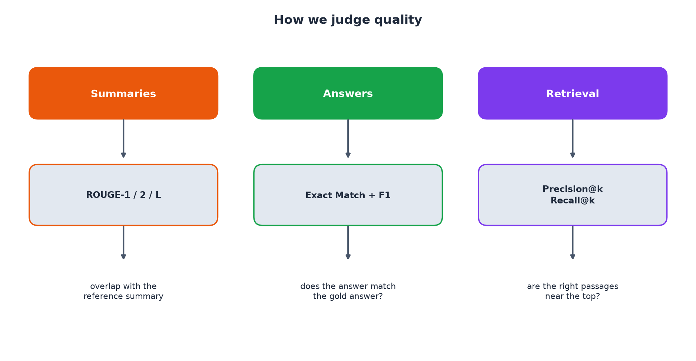
</p>

| Metric | In plain words |
| --- | --- |
| ROUGE-1 / 2 / L | Word, word-pair and longest-sequence overlap with a human summary |
| Exact Match | Did the answer equal the gold answer exactly? |
| F1 | Partial credit for word overlap with the gold answer |
| Precision@k | Share of the top *k* passages that are relevant |
| Recall@k | Share of all relevant passages found in the top *k* |

---

## 🖥 The app

<p align="center">
  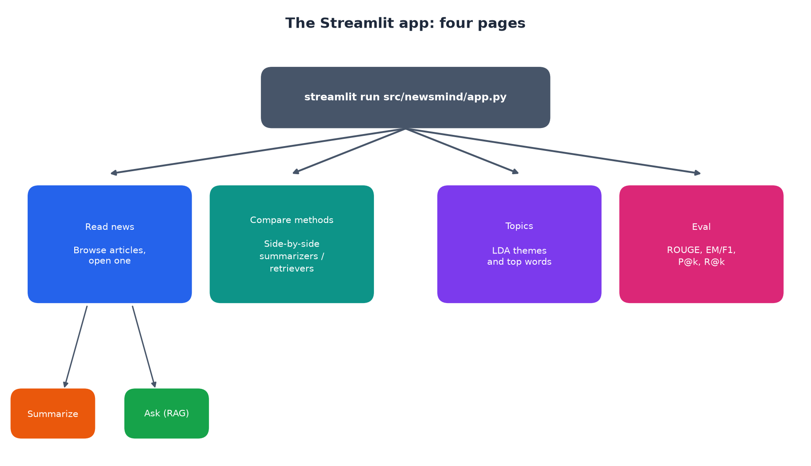
</p>

- **Read news**: browse articles, open one, then **Summarize** or **Ask**.
- **Compare methods**: summarizers or retrievers side by side.
- **Topics**: explore the LDA themes.
- **Eval**: inspect quality metrics.

---

## 🚀 Quick start

> Requires **Python 3.12+** and [`uv`](https://docs.astral.sh/uv/).

```bash
# 1. Install
uv sync

# 2. Ingest data
uv run newsmind-hf               # Hugging Face datasets
uv run newsmind-rss              # official RSS feeds
uv run newsmind-scale            # stream up to ~10M rows
uv run newsmind-outlets          # named papers from CC-News (legal archive)

# 3. Build the RAG index
uv run newsmind-index --limit 10000     # quick
uv run newsmind-index                   # full working set (100,000 articles)

# 4. Launch the app
uv run streamlit run src/newsmind/app.py
```

| Command | What it does |
| --- | --- |
| `newsmind-hf` | Download Hugging Face news corpora to Parquet |
| `newsmind-rss` | Snapshot live RSS headlines and blurbs |
| `newsmind-scale` | Stream public sets until the corpus nears 10M rows |
| `newsmind-outlets` | Filter named outlets out of CC-News |
| `newsmind-index` | Chunk, embed and save the hybrid search index |

> ⏱ The full index embeds hundreds of thousands of chunks with MiniLM and takes a while on
> CPU (roughly 20 to 30 minutes on a recent laptop). Use `--limit` for a quick build.

---

## 🔧 Configuration

Everything tunable lives in `src/newsmind/config.py`:

| Setting | Default | Meaning |
| --- | --- | --- |
| `TARGET_CORPUS_ROWS` | 10,000,000 | Goal for the scaled corpus |
| `WORKING_SET_SIZE` | 100,000 | Articles indexed by default |
| `CHUNK_SIZE_CHARS` / `CHUNK_OVERLAP_CHARS` | 900 / 120 | Passage size and overlap |
| `HYBRID_ALPHA` | 0.55 | Weight on dense scores in fusion |
| `RETRIEVE_TOP_K` | 20 | Fused candidates passed to the reranker |
| `RERANK_TOP_K` | 5 | Passages given to the generator |
| `DENSE_MODEL`, `RERANK_MODEL`, `GENERATOR_MODEL`, … | see file | Swap models freely |

---

## 🧱 Project layout

<p align="center">
  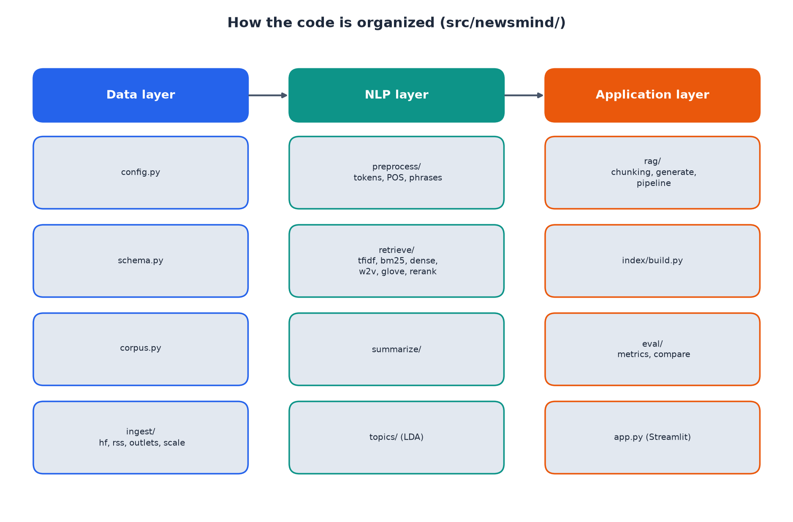
</p>

```text
nlp/
├── src/newsmind/
│   ├── config.py  schema.py  corpus.py  app.py
│   ├── ingest/       hf_download, rss_ingest, outlet_archive, scale_10m, feeds
│   ├── preprocess/   tokenization, lemmas, POS, noun phrases
│   ├── retrieve/     tfidf, bm25, dense, hybrid, reranker, word2vec, glove
│   ├── summarize/    extractive and abstractive summarizers
│   ├── rag/          chunking, generate, pipeline
│   ├── index/        build.py
│   ├── topics/       LDA
│   └── eval/         metrics and method comparison
├── tests/            smoke tests
├── docs/             report, diagrams and their generator scripts
└── data/             raw/ parquet corpora, index/ saved search index
```

---

## 📈 Current index

<p align="center">
  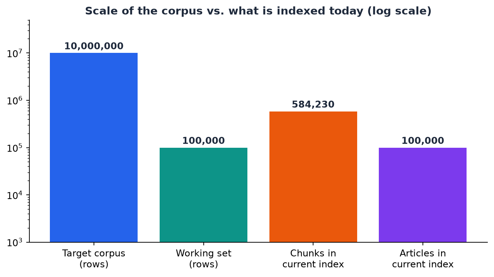
</p>

| Property | Value |
| --- | --- |
| Working set | **100,000 articles** |
| Searchable chunks | **584,230** |
| Corpora in the index | `cnn_dailymail`, `rss_live` |
| Embedding model | `all-MiniLM-L6-v2` |
| Reranker | `ms-marco-MiniLM-L-6-v2` |

The raw corpus on disk (about 3.9 GB) is larger than what is indexed; raise `--limit` to
index more.

---

## ✅ Quality checks

<p align="center">
  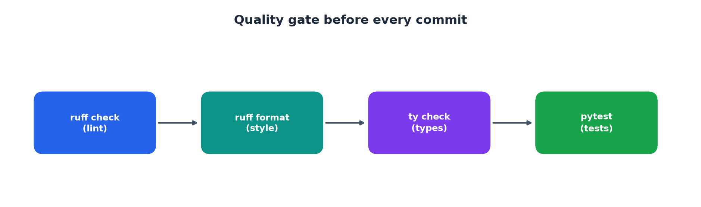
</p>

```bash
uv run ruff check && uv run ruff format --check && uv run ty check && uv run pytest -q
```

---

## ⚠️ Limitations and roadmap

**Limits to be aware of**

- FLAN-T5-base is small and can be shallow on questions spanning many articles.
- Only the 100,000-article working set is indexed, not the whole corpus.
- Abstractive summaries can still contain factual errors.
- Models read roughly 1,024 tokens at a time.
- The flat FAISS index is exact but not meant for 10M vectors without tuning.

**Roadmap**

- [ ] Approximate FAISS (IVF / HNSW) to index the full corpus
- [ ] Larger instruction-tuned generator
- [ ] Indian-language support for regional outlets
- [ ] Automatic fact-consistency checks for summaries
- [ ] Time-aware retrieval to favour fresh news

---

## 📚 Documentation and glossary

A full illustrated report is in [`docs/NewsMind_Project_Report.docx`](docs/NewsMind_Project_Report.docx).
Regenerate it and its diagrams with:

```bash
uv run --no-project --with matplotlib --with numpy python docs/make_diagrams.py
uv run --no-project --with python-docx python docs/make_report.py
```

| Term | Meaning |
| --- | --- |
| Corpus | A large collection of text documents |
| Lemma | Dictionary form of a word (*climbing → climb*) |
| Embedding | Numbers that represent the meaning of a word or sentence |
| FAISS | Library for fast nearest-neighbour search over embeddings |
| Cross-encoder | Model that reads a question and passage together to judge relevance |
| RAG | Retrieval-Augmented Generation: look things up first, then write |
| Extractive / Abstractive | Copy sentences / write new ones |
| LDA | Method that discovers hidden topics from word patterns |
| ROUGE | Metric comparing a machine summary with a human one |

---

<div align="center">

**Author:** Srijan Baniyal · **Version:** 0.1.0 · Built for *Fundamentals of NLP* (PBL)

</div>
